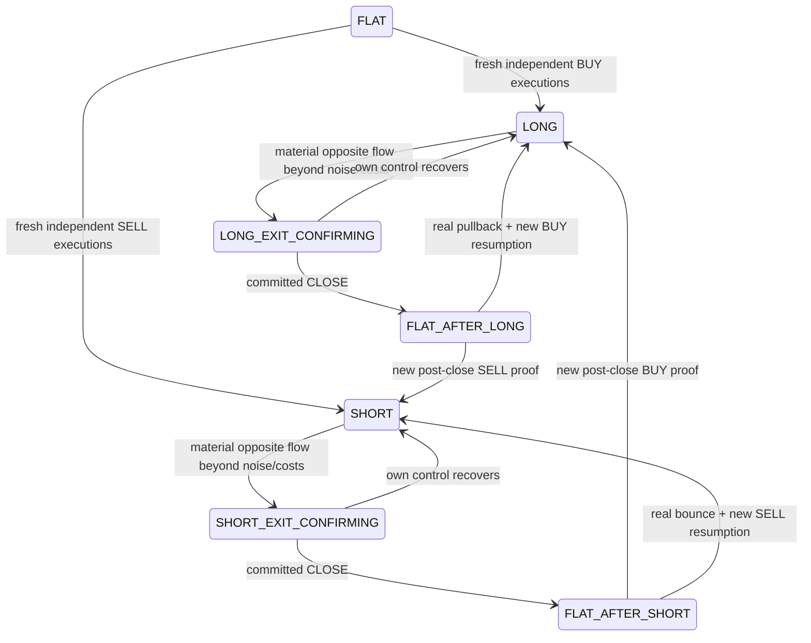

# PANDORA Flow v2 — готовая поставка

Ветка GitHub: `pandora-flow-v2`. Базовая версия: `953a888`. `main` и Render deploy не изменяются этой поставкой. PAPER ONLY.

## Результат

Новый эксперимент `pandora_flow_v2`: поток Bybit Public Trades определяет направление и подтверждения, а час выбирает только entry universe. Нормальные OPEN/CLOSE/REENTRY/REVERSAL требуют новых принятых executions; polling не наращивает evidence. Риск, sizing, leverage, fees/slippage estimate, maintenance и compounding сохранены в исходных `pandora_risk.py`/`accounting.py`; SHA-256 совпадают с baseline.

Архитектура: transport → ordered accepted events → FlowStrategy → sequential PAPER account writer → PostgreSQL schema `pandora_flow_v2` → read-only API/monitor. HourlyUniverse фиксирует пять entry symbols и сохраняет schedule; открытые исключённые позиции остаются MANAGED_POSITION.

## Проверки

- Полный suite: **260 уникальных тестов PASS**, 0 failures/errors/skips. [Машинный отчёт](validation/release-result.json), [лог](validation/release.log).
- Acceptance **1–16: каждый PASS**. [Отдельные результаты и фактические test IDs](validation/flow-acceptance.json), [лог](validation/flow-acceptance.log).
- Active AST/grep: **82 функций**, 0 нарушений и 0 scoped grep hits. [Proof](validation/flow-decision-path.json). Historical UI/helper code вне активных roots не выдаётся за торговую зависимость.
- Chromium 320/390/768 px: чистый новый account, без JS errors/переполнения. [Результат](validation/flow-monitor.json). Дополнительные UI-сценарии проверяют live JSON updates, precision и MANAGED_POSITION.

## Факт однократного reset

Выполнен **после готового кода и успешных тестов**, в доступной **локальной PostgreSQL `pandora_dev`**. Отчёт: [paper-reset-local.json](validation/paper-reset-local.json).

| Показатель | Проверено |
| --- | --- |
| Experiment/schema | pandora_flow_v2 |
| Start / Equity | 500 / 500 USDT |
| Realized / Unrealized / Total PnL | 0 / 0 / 0 |
| Open positions / Closed trades | 0 / 0 |
| Watch / Pyramid adds / Token state / Strategy runtime | пусто |
| Первый initialize | true |
| Повторный initialize | false, данные сохранены |
| Restart | account сохранён |
| Старый namespace | не изменён, не участвует в monitor/PnL |

**Reset рабочей Render PostgreSQL не выполнен и не подтверждён:** в этой сессии нет её credentials/инструментов. Изоляция, reset CLI и миграция готовы; наличие локального отчёта не означает применение к Render. Startup требует registry marker; при его отсутствии не торгует и не сбрасывает account самостоятельно. Render deploy не выполнялся.

## Decision state machine

Flow regimes: BUY_CONTROL / BUY_WEAKENING / NEUTRAL / SELL_WEAKENING / SELL_CONTROL. Position states: FLAT / LONG / LONG_EXIT_CONFIRMING / FLAT_AFTER_LONG / SHORT / SHORT_EXIT_CONFIRMING / FLAT_AFTER_SHORT. DATA_UNCERTAIN — отдельный статус доступности данных.

При data loss stale само по себе не закрывает позицию. Нельзя добавлять directional risk; отдельная protective policy допускает только уменьшение позиции по свежему независимому mark, который пробивает наблюдавшуюся flow-границу с учётом costs/noise. Нет fixed TP/SL и нет stale-based reversal.

## Аудит и ключевые diff

[Таблица FILE / FUNCTION / CURRENT LOGIC / WHY / REPLACEMENT, ключевые before/after diff и acceptance matrix](PANDORA_FLOW_V2_AUDIT.md). Настройки и запуск: [README](README_PANDORA_WIN.md). Передача: [handoff](PANDORA_WIN_HANDOFF.md).

## Полный список изменённых/созданных файлов

A — создан, M — изменён, D — удалён из новой ветки. Архивы тестов v1 сохраняют явно отменённые H1-directed контракты; они не исполняются как acceptance нового engine.

| Файл | Статус |
| --- | --- |
| `.github/workflows/tests.yml` | M |
| `MANIFEST.json` | M |
| `PANDORA_FLOW_V2_AUDIT.md` | A |
| `PANDORA_FLOW_V2_COMPLETE.zip` | A |
| `PANDORA_FLOW_V2_COMPLETE.zip.sha256` | A |
| `PANDORA_FLOW_V2_DELIVERY.md` | A |
| `PANDORA_WIN_COMPLETE.zip` | D |
| `PANDORA_WIN_COMPLETE.zip.sha256` | D |
| `PANDORA_WIN_HANDOFF.md` | M |
| `README.md` | M |
| `README_PANDORA_WIN.md` | M |
| `app.py` | M |
| `market_data.py` | M |
| `pandora_api.py` | M |
| `pandora_decisions.py` | M |
| `pandora_experiment.py` | A |
| `pandora_flow_strategy.py` | A |
| `pandora_monitor.py` | M |
| `pandora_runtime.py` | M |
| `pandora_scanner.py` | M |
| `pandora_universe.py` | A |
| `pandora_win_core.py` | M |
| `scripts/audit_flow_decision_path.py` | A |
| `scripts/package_source.py` | M |
| `scripts/reset_paper_experiment.py` | A |
| `scripts/run_flow_acceptance.py` | A |
| `tests/archive_v1/README.md` | A |
| `tests/archive_v1/incident_integration_v1.py` | A |
| `tests/archive_v1/pandora_end_to_end_v1.py` | A |
| `tests/archive_v1/persistent_pyramid_h1_v1.py` | A |
| `tests/archive_v1/runtime_h1_gate_v1.py` | A |
| `tests/test_app_risk_audit.py` | M |
| `tests/test_bootstrap_safety.py` | M |
| `tests/test_flow_v2_decision_path.py` | A |
| `tests/test_flow_v2_events.py` | A |
| `tests/test_flow_v2_integration.py` | A |
| `tests/test_flow_v2_monitor.py` | A |
| `tests/test_flow_v2_reset.py` | A |
| `tests/test_flow_v2_strategy.py` | A |
| `tests/test_flow_v2_universe.py` | A |
| `tests/test_incident_integration.py` | M |
| `tests/test_pandora_end_to_end.py` | D |
| `tests/test_pandora_history_preservation.py` | M |
| `tests/test_pandora_restoration.py` | M |
| `tests/test_pandora_win.py` | M |
| `tests/test_runtime_audit.py` | M |
| `tests/test_signal_audit.py` | M |
| `tests/test_startup_decisions.py` | M |
| `validation/flow-acceptance.json` | A |
| `validation/flow-acceptance.log` | A |
| `validation/flow-decision-path.json` | A |
| `validation/flow-monitor.json` | A |
| `validation/paper-reset-local.json` | A |
| `validation/release-result.json` | M |
| `validation/release.log` | M |
