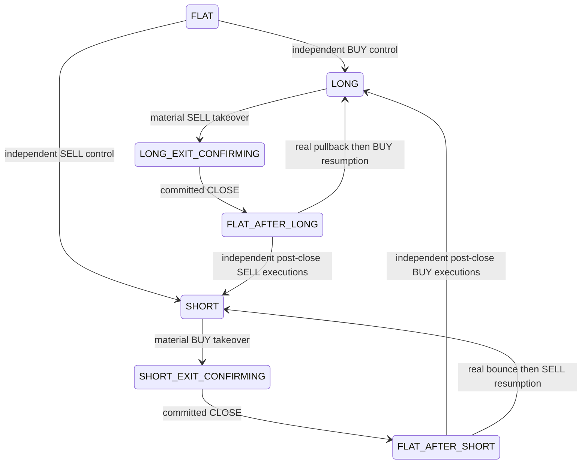

# PANDORA Flow v2 — PAPER

Python 3.12, PostgreSQL, Bybit V5 Public REST/WebSocket. Стратегия торгует по фактическим агрессивным BUY/SELL executions. Исторические H1/M15 helpers и candle-поля могут оставаться для совместимости; active OPEN/CLOSE/HOLD/REENTRY/REVERSAL не используют их.

## Новый эксперимент и controlled reset

`pandora_flow_v2` использует одноимённую PostgreSQL-схему. Соединения приложения имеют только этот search path, без fallback в `public`. Старые `public.pandora_win_*` остаются архивом и не участвуют в новом monitor/account/PnL.

После готового кода и успешных тестов, при остановленном writer нового эксперимента:

```bash
python scripts/reset_paper_experiment.py
```

`DATABASE_URL` задаётся безопасно в окружении. Скрипт атомарно создаёт пустой namespace, таблицы и registry marker. Start/Equity = 500 USDT; Realized/Unrealized/Total PnL = 0; open positions/closed trades = 0; watch, FSM, pyramid и MFE/MAE пусты. Непустая незарегистрированная схема и активный writer блокируют первую инициализацию; destructive force-флага нет.

Повторная команда возвращает сохранённый новый account, не удаляя новые сделки. Startup требует initialized marker и восстанавливает состояние; reset на restart отсутствует. Тестовая инициализация сама по себе не подтверждает reset рабочей PostgreSQL.

## Компоненты и active decision path

| Файл | Назначение |
| --- | --- |
| `app.py` | HTTP, account, атомарные PAPER OPEN/CLOSE, mark и flow dispatch |
| `pandora_flow_strategy.py` | Чистая FSM: control, price response, absorption, hysteresis, re-entry/reversal, uncertainty |
| `market_data.py`, `exchange_trade_adapter.py` | Валидация/дедупликация trades, sequences, exchange/receive times, replay принятых событий |
| `bybit_market_stream.py` | Public WS, ACK/subscriptions/reconnect и freshness |
| `pandora_scanner.py` | Непрерывный обзор linear USDT perpetual и ranking по движению/активности |
| `pandora_universe.py` | Фиксированный hourly TOP-5, UTC schedule, metadata и MANAGED_POSITION |
| `pandora_runtime.py` | Связь FSM с account writer, checkpoints, managed positions, journal |
| `pandora_win_core.py` | Pyramiding, quantity-weighted average entry, MFE/MAE |
| `pandora_risk.py`, `accounting.py` | Сохранённые sizing/leverage, costs, maintenance и net PAPER PnL |
| `pandora_experiment.py` | Изолированный namespace и однократный initializer |
| `pandora_monitor.py`, `pandora_api.py`, `pandora_decisions.py` | Flow monitor, startup/WAIT и read-only API |
| `engine_store.py` | Single-writer lease/fence |
| `scripts/audit_flow_decision_path.py` | AST dependency proof, scoped grep и money-engine hashes |
| `scripts/run_flow_acceptance.py` | Отдельный результат каждого acceptance 1–16 с PostgreSQL/WS contracts |
| `scripts/reset_paper_experiment.py` | Явная controlled инициализация нового эксперимента |
| `scripts/package_source.py` | Source ZIP и SHA-256 manifest без credentials/баз/venv |

Путь: новый принятый Public Trade → event sequence → `FlowStrategy.ingest` → measurement/control/FSM → recommendation → повторная проверка tape/mark/capital → fenced PAPER transaction → `on_open`/`on_close`. Recommendation не равна committed позиции.

`FlowStrategy._analysis(token, flow, side)` — adapter к неизменённому risk engine. `anchor_confirmed`, `entry_side`, `pivot_price`, `pressure_state` выводятся только из flow и исполненных цен. Исторические имена полей не означают H1/M15. Risk planning reference не является stop order.

## Executed flow и state machine

Каждый независимый execution обновляет BUY/SELL notional/quantity/count/ratio, imbalance, velocity/acceleration, price response, absorption, fast/sustained/context control и freshness/sequence validity. Окна 5/15/30/60/180/300s служат измерению. Engine не ждёт их закрытия или полного покрытия. Polling без новых trades не добавляет confidence, persistence или confirmation.

Flow regimes: BUY_CONTROL, BUY_WEAKENING, NEUTRAL, SELL_WEAKENING, SELL_CONTROL.



Control использует прежний imbalance 0.20 (60/40 notional), положительный causal response и отсутствие absorption. Новый named `FlowConfig.min_control_events=3` требует независимых executions вместо прежнего ожидания секунд. Measurement/retention параметры именованы в `FlowConfig`; это программные гипотезы, не оптимизированные параметры доходности.

Micro-pullback/bounce удерживается при сохранённом broader control. Выход требует материального встречного движения, противоположного control и цены за learned-noise/cost boundary. Round-trip fee/slippage берутся из прежнего `RiskPolicy`. Reversal не переиспользует trade закрытия: evidence начинается после actual CLOSE acknowledgement. Re-entry count искусственно не ограничен.

Stale/invalid tape → DATA_UNCERTAIN, запрет entry и directional reversal. Staleness сама по себе не закрывает позицию. Отдельная data-loss policy может закрыть риск при свежем независимом mark, который пробивает прежнюю flow boundary дальше noise/cost allowance. Maintenance guard остаётся отдельным сохранённым денежным ограничением. Новые восстановленные executions сразу пересчитывают реальный control.

## Hourly TOP-5 и managed positions

Discovery продолжает видеть весь рынок. `HourlyUniverse` фиксирует до пяти подходящих свежих рынков на первом refresh и меняет entry set только на следующей UTC-границе часа. Внутри часа rank не меняет membership. Час выбирает рынки, а не LONG/SHORT.

Checkpoint сохраняет rank, 24h change, selection/current price, turnover, volume, reason, selected_at и last/next refresh. Restart восстанавливает schedule; пропущенные часы не проигрываются. Outage не расходует refresh и не удаляет прежний entry set.

Hourly refresh согласован с Public REST перечитыванием contract metadata и ticker reconciliation. Новая selection публикуется после актуализации списка контрактов в текущем UTC-часе. Это условие обновления membership; непрерывный flow executor продолжает управлять позициями и не ждёт REST/hourly refresh для directional decisions.

Открытый токен вне TOP-5 становится MANAGED_POSITION: продолжаются Public Trades, mark, MFE/MAE и flow exit. Ротация не вызывает CLOSE. После закрытия токен вне entry set не получает новый entry.

## Деньги, запуск и monitor

`pandora_risk.py` и `accounting.py` сохранены byte-for-byte; audit проверяет SHA-256 baseline. Новый вход использует прежние margin 10–30% и leverage 10–50x до contract/cash/maintenance constraints. ADD сохраняет sizing/account limits и требует свежего same-side continuation. Average entry quantity weighted. Compounding использует текущий net account.

Account/позиции/trade history/ADDs и OPEN/CLOSE защищены fenced transactions и account serialization. FSM/universe/token state checkpointed в новой схеме. Незакоммиченные наблюдения могут потеряться при аварии. MFE/MAE/peak/giveback/fees/net PnL сохраняются как аналитика. Fixed TP/SL, MFE percentage exits и PnL-based pauses отсутствуют.

```bash
python3.12 -m venv .venv
. .venv/bin/activate
pip install -r requirements.txt
# DATABASE_URL задаётся вне исходников; сначала controlled initializer.
python app.py
```

Нужны публичные HTTPS/WSS api.bybit.com и stream.bybit.com; торговый ключ не нужен. Сохраняйте TLS verification/CA/proxy. Не запускайте два writer на одном PAPER account.

Money параметры прежние: PANDORA_MIN_MARGIN_FRACTION=.10, PANDORA_MAX_ENTRY_MARGIN_FRACTION=.30, PANDORA_MIN_LEVERAGE=10, PANDORA_MAX_LEVERAGE=50, PANDORA_MAX_ADDS=2, PANDORA_ADD_MARGIN_FRACTION=.10, PANDORA_MAX_POSITION_MARGIN_FRACTION=.40. PORT=10000; DATABASE_URL обязателен. Freshness/retention именованы в collector/FlowConfig.

Monitor `/` показывает account, hourly TOP-5/schedule, managed positions, flow evidence, actual side/FSM, latest exchange/receive times и причины. Позиция показывает entry/mark/margin/notional/leverage/PnL/MFE/MAE/giveback. Stale mark не выдаётся за текущий PnL.

Маршруты: `/api/pandora` (корень pandora), `/api/pandora/history`, `/pandora/history`, `/api/pandora/events`, `/openapi.json`, `/health`, `/health/risk`. History и PnL относятся только к новому эксперименту.

## Проверка и выпуск

```bash
python scripts/audit_flow_decision_path.py --report validation/flow-decision-path.json
python scripts/run_release_tests.py --report validation/release-result.json
python scripts/run_flow_acceptance.py --report validation/flow-acceptance.json
```

Runner требует DATABASE_URL отдельной тестовой PostgreSQL и PANDORA_TEST_DATABASE_URL_FILE с тем же URL. Synthetic sequence, loopback WebSocket и PostgreSQL contracts не являются backtest/доказательством прибыли. Acceptance matrix и baseline table: [PANDORA_FLOW_V2_AUDIT.md](PANDORA_FLOW_V2_AUDIT.md).

Ветка выпуска — pandora-flow-v2. Код, tests, controlled reset и source ZIP готовятся до запуска. **Render deploy не выполняется без отдельной команды пользователя.** Local/test PostgreSQL, production reset, live exchange и Render — отдельные проверяемые факты; отчёт должен различать их.
